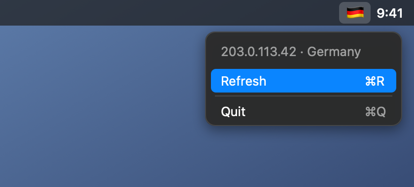

# FlagSentry

[](https://github.com/4yvi/flag-sentry/actions/workflows/ci.yml)
[](LICENSE)
[](https://github.com/4yvi/flag-sentry/releases/latest)

A tiny macOS menu-bar app that shows the flag of the country of your current public IP address and sends a notification when the IP changes (handy for checking that your VPN is really on).

<p align="center"></p>
<p align="center"><sub>Illustration with a sample IP address (203.0.113.42, reserved for documentation).</sub></p>

- Lives in the menu bar only (no Dock icon)
- Checks every 30 seconds and on network changes
- Sandboxed, network client access only
- Optional launch at login

Requires macOS 13 or newer.

## Install

1. Download `FlagSentry-<version>-macos.zip` from the [latest release](https://github.com/4yvi/flag-sentry/releases/latest) (or a fresh build from the [Actions](https://github.com/4yvi/flag-sentry/actions) artifacts).
2. Unzip and move `FlagSentry.app` to `/Applications`.
3. The app is ad-hoc signed, not notarized by Apple. On first launch right-click the app, choose **Open**, and confirm. Or run:
   ```
   xattr -dr com.apple.quarantine /Applications/FlagSentry.app
   ```

Each release also ships a `.sha256` file to verify the download.

## Build from source

```
./build.sh                                      # builds build/FlagSentry.app
BUNDLE_ID=com.yourname.FlagSentry ./build.sh    # custom bundle identifier
VERSION=1.2.3 ./build.sh                        # custom version
swift test                                      # unit tests
```

Needs the Xcode command line tools (Swift 5.7+). See [SETUP.md](SETUP.md) for the Xcode alternative.

## Privacy

The app asks `http://ip-api.com` for your public IP and its country. This service is queried over plain HTTP on purpose: its free tier has no HTTPS, and HTTPS alternatives have daily limits below this app's polling rate. Because of that every response field is validated and sanitized before it is shown (see `ResponseParser` in `Core.swift`). Nothing else is sent, collected or stored.

## Contributing

Issues and pull requests are welcome, see [CONTRIBUTING.md](CONTRIBUTING.md). Please follow the [Code of Conduct](CODE_OF_CONDUCT.md). Report security problems as described in [SECURITY.md](SECURITY.md).

## License

[MIT](LICENSE) © 2026 Alexey Trofimov
